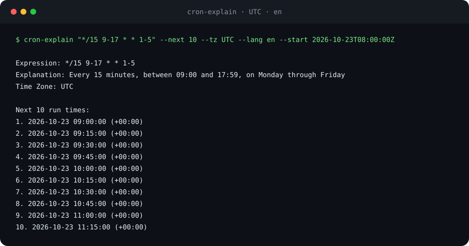

# cron-explain

[](https://github.com/YusufBeratZengin/cron-explain/actions/workflows/ci.yml) [](LICENSE) [](https://www.npmjs.com/package/cron-explain)  

English | [Türkçe](README.tr.md)

Parse, validate, and explain cron expressions in English, Turkish, German or Spanish, and list future runs in an IANA time zone.
Runs offline on Node.js >=20 with ESM and zero dependencies.



## Why cron-explain?

- Four explanation languages, including natural Turkish suffix rules.
- Unix, Quartz and AWS EventBridge syntax, schedule comparison and terminal calendars in one CLI and ESM library.
- Zero runtime dependencies, offline processing, and reproducible text or JSON output.

## Quick start

Try the public checkout with Node.js >=20; no package installation is needed:

```bash
git clone https://github.com/YusufBeratZengin/cron-explain.git
cd cron-explain
node bin/cron-explain.js "*/15 9-17 * * 1-5" --next 10 --tz UTC --lang en --start 2026-10-23T08:00:00Z
```

The command prints the transcript below. For npm distribution, see [Install](#install).

## Demo

<!-- demo-command -->
<!-- check-readme -->
```console
$ cron-explain "*/15 9-17 * * 1-5" --next 10 --tz UTC --lang en --start 2026-10-23T08:00:00Z
Expression: */15 9-17 * * 1-5
Explanation: Every 15 minutes, between 09:00 and 17:59, on Monday through Friday
Time Zone: UTC

Next 10 run times:
1. 2026-10-23 09:00:00 (+00:00)
2. 2026-10-23 09:15:00 (+00:00)
3. 2026-10-23 09:30:00 (+00:00)
4. 2026-10-23 09:45:00 (+00:00)
5. 2026-10-23 10:00:00 (+00:00)
6. 2026-10-23 10:15:00 (+00:00)
7. 2026-10-23 10:30:00 (+00:00)
8. 2026-10-23 10:45:00 (+00:00)
9. 2026-10-23 11:00:00 (+00:00)
10. 2026-10-23 11:15:00 (+00:00)
```

The start date is fixed so you can reproduce the output. Use `--lang tr` for Turkish:

<!-- check-readme -->
```console
$ cron-explain "*/15 9-17 * * 1-5" --next 2 --tz UTC --lang tr --start 2026-10-22T08:00:00Z
İfade: */15 9-17 * * 1-5
Açıklama: Hafta içi her gün 09:00 ile 17:59 arasında her 15 dakikada bir
Zaman Dilimi: UTC

Sonraki 2 Çalışma Zamanı:
1. 2026-10-22 09:00:00 (+00:00)
2. 2026-10-22 09:15:00 (+00:00)
```

## Install

Once the package is available on npm:

```bash
npm install cron-explain
# Or install the CLI globally:
npm install --global cron-explain
```

The npm version badge reflects registry availability; it may be unavailable before the first publication.
To try the checkout without installing, replace `cron-explain` with `node bin/cron-explain.js` in the examples.

## Usage

Supports 5 fields (minute, hour, day of month, month, day of week), 6 fields
(with seconds, or a trailing four-digit year/range), and 7 fields (seconds through year).
Quartz syntax includes `?`, `L`, `LW`, `L-n`, `nW`, `dL`, and `d#n`.
Aliases: `@yearly`, `@annually`, `@monthly`, `@weekly`, `@daily`, `@midnight`, `@hourly`, `@reboot`.

### EventBridge and Quartz

AWS EventBridge uses `cron(minute hour day-of-month month day-of-week year)`:
six fields, no seconds, years 1970–2199, and exactly one `?` in the two day fields.
Weekdays are 1=Sunday through 7=Saturday. A bare six-field expression can be selected
with `--type eventbridge` or `parseCron(text, { type: 'eventbridge' })`.
The wrapper is detected automatically; bare expressions retain the existing auto rules.
EventBridge rejects weekday steps and lists containing `#`.

Quartz uses seconds first, with an optional seventh year field (1970–2099).
Use `--type quartz` to select it explicitly. Supported day specials are case insensitive:
`L` (last day), `LW` (last weekday), `L-3`, `15W` (nearest weekday without crossing
the month), `FRIL` (last Friday), and `MON#3` (third Monday).
See the [AWS syntax reference](https://docs.aws.amazon.com/scheduler/latest/UserGuide/schedule-types.html)
and [Quartz tutorial](https://www.quartz-scheduler.org/documentation/quartz-2.2.2/tutorials/crontrigger).
The library retains its existing local DST policies; it does not emulate a hosted scheduler.
Use `--tz UTC` for UTC-based EventBridge rules.

```bash
cron-explain "cron(0 12 ? * MON-FRI *)" --lang de --tz UTC --start 2026-10-30T00:00:00Z
cron-explain "0 12 ? * MON-FRI *" --type eventbridge --lang es --tz UTC --start 2026-10-30T00:00:00Z
cron-explain "15 0 9 LW * ?" --type quartz --next 3 --tz UTC --start 2026-10-30T00:00:00Z
```

### Compare schedules

`diff` merges the two schedules and shows the next `--next N` **distinct instants**
in chronological order, marked `A only`, `B only` or `both`. The count is a limit on
the merged result, not on differences alone. Matching schedules still show `both`.
Both expressions share `--start`, `--tz`, `--dst` and `--type`; quote each expression.
An optional `--days N` restricts the window to `(start, start + N × 24 hours]`.
Without it, searches use each dialect's supported year limit.

```bash
cron-explain diff "*/15 * * * *" "*/20 * * * *" --next 8 --tz UTC --start 2026-10-30T00:00:00Z
cron-explain diff "@daily" "0 12 * * *" --days 7 --format json --tz UTC --start 2026-10-30T00:00:00Z
```

<!-- check-readme -->
```console
$ cron-explain diff "*/15 * * * *" "*/20 * * * *" --next 6 --tz UTC --start 2026-10-30T00:00:00Z
Expression A: */15 * * * *
Explanation A: Every 15 minutes
Expression B: */20 * * * *
Explanation B: Every 20 minutes
Time Zone: UTC

Next 6 run times:
1. [A only] 2026-10-30 00:15:00 (+00:00)
2. [B only] 2026-10-30 00:20:00 (+00:00)
3. [A only] 2026-10-30 00:30:00 (+00:00)
4. [B only] 2026-10-30 00:40:00 (+00:00)
5. [A only] 2026-10-30 00:45:00 (+00:00)
6. [both] 2026-10-30 01:00:00 (+00:00)
```

JSON includes `a`, `b`, `timeZone`, `days`, `windowStart`, `windowEnd` and `runs`.
Each run contains `source` (`a`, `b`, `both`), `utc` and `formatted`.
`days` and `windowEnd` are null without a window. No scheduled runs produces an
empty list and exit code 0; this does not assert equivalence beyond the shown results.

### Monthly calendar

```bash
cron-explain "@daily" --calendar --next 10 --tz Europe/Istanbul --lang tr --start 2026-10-30T00:00:00Z
```

`--calendar` replaces the text run list with Monday-first month grids for the next
`--next N` runs. Each relevant month has a `YYYY-MM` heading. `DD:n` counts selected
runs on that local date; `DD .` means no selected runs, not that the schedule never
runs that day. Counts are exact, including values above 99. Sparse schedules may
span several years; only months containing selected runs are printed.
`--next 0`, `@reboot` and exhausted schedules give an empty calendar.
JSON preserves `nextRuns` and adds `calendar: [{ date: 'YYYY-MM-DD', runs: n }]`.
`--calendar` cannot be combined with `diff`.

### Library API

```js
import { validateCron, parseCron, explainCron, getNextRunTimes, formatZonedDate } from 'cron-explain';

const expression = '*/15 9-17 * * 1-5';
const validation = validateCron(expression);
const parsed = parseCron(expression);
const explanation = explainCron(parsed, { lang: 'tr' });
const runs = getNextRunTimes(parsed, {
  startDate: '2026-10-22T08:00:00Z',
  timeZone: 'Europe/Istanbul',
  count: 2,
  dstPolicy: 'skip',
});
const formatted = runs.map((date) => formatZonedDate(date, 'Europe/Istanbul'));
```

`getNextRunTimes` returns `Date[]`; the start is exclusive. `parseCron` throws
`CronValidationError` for invalid input; `validateCron` returns a validation result.
Time zone utilities and Turkish grammar helpers are also exported; see [src/index.js](src/index.js).

```js
import { parseCron, explainCron, compareSchedules, getCalendar, renderCalendar, findOverlaps } from 'cron-explain';

const options = { startDate: '2026-10-30T00:00:00Z', timeZone: 'UTC', count: 8 };
const aws = parseCron('0 12 ? * MON-FRI *', { type: 'eventbridge' });
const german = explainCron(aws, { lang: 'de' }); // en, tr, de, es; unknown codes fall back to en
const comparison = compareSchedules('*/15 * * * *', '*/20 * * * *', options);
// comparison.runs: [{ date: Date, source: 'a' | 'b' | 'both' }]; windowEnd: Date | null
const calendar = getCalendar('@daily', options);
// calendar.days: [{ date: 'YYYY-MM-DD', weekday: 0..6 (Monday first), runs: number }]
const text = renderCalendar(calendar); // optional { weekdays: ['Mon', ..., 'Sun'] }
const common = findOverlaps('@daily', '0 0 * * *', { ...options, days: 7, limit: 3 });
// common: { overlaps: Date[], total, capped, windowEnd: Date }
```

`compareSchedules` and `getCalendar` accept strings or parsed expressions and the
same scheduling options as `getNextRunTimes`; starts are exclusive, `count` defaults
to 5 and may be zero. Comparison also accepts an optional positive `days` window.
`findOverlaps` counts shared runs within a window (default 365 days), retaining the
first `limit` (default 10); `maxRuns` (default 200000 per expression) caps its scan.
If `capped` is true, `total` is a partial count. `getCalendar` returns `capped: false`
because it groups a fixed number of runs. Existing API signatures and default
English/Turkish output remain compatible.

### JSON output

<!-- check-readme -->
```console
$ cron-explain "0 0 1 1 *" --next 1 --tz UTC --lang en --format json --start 2026-10-22T00:00:00Z
{
  "expression": "0 0 1 1 *",
  "explanation": "At 00:00, on day 1 of the month, in January",
  "timeZone": "UTC",
  "isReboot": false,
  "neverMatches": false,
  "nextRuns": [
    {
      "utc": "2027-01-01T00:00:00.000Z",
      "formatted": "2027-01-01 00:00:00 (+00:00)"
    }
  ]
}
```

## Examples

[examples/basic.mjs](examples/basic.mjs) validates, explains, and calculates future runs:

<!-- check-readme -->
```console
$ node examples/basic.mjs
Valid: true
Every 15 minutes, between 09:00 and 17:59, on Monday through Friday
Hafta içi her gün 09:00 ile 17:59 arasında her 15 dakikada bir
2026-10-22T09:00:00.000Z
2026-10-22T09:15:00.000Z
```

[examples/quartz.mjs](examples/quartz.mjs) demonstrates the three special schedules below:

<!-- check-readme -->
```console
$ node examples/quartz.mjs
0 0 12 ? * 2#3: At 12:00, on the 3rd Monday of the month
2026-11-16T12:00:00.000Z
0 0 L * ?: At 00:00, on the last day of the month
2026-10-31T00:00:00.000Z
0 15 10 ? * 6L: At 10:15, on the last Friday of the month
2026-10-30T10:15:00.000Z
```

### Quartz examples

Quartz uses 1=Sunday through 7=Saturday. A fifth occurrence skips months that do not have one.

<!-- check-readme -->
```console
$ cron-explain "0 0 12 ? * 2#3" --next 2 --tz UTC --lang en --start 2026-10-22T00:00:00Z
Expression: 0 0 12 ? * 2#3
Explanation: At 12:00, on the 3rd Monday of the month
Time Zone: UTC

Next 2 run times:
1. 2026-11-16 12:00:00 (+00:00)
2. 2026-12-21 12:00:00 (+00:00)
```

<!-- check-readme -->
```console
$ cron-explain "0 0 L * ?" --next 2 --tz UTC --lang en --start 2026-10-22T00:00:00Z
Expression: 0 0 L * ?
Explanation: At 00:00, on the last day of the month
Time Zone: UTC

Next 2 run times:
1. 2026-10-31 00:00:00 (+00:00)
2. 2026-11-30 00:00:00 (+00:00)
```

<!-- check-readme -->
```console
$ cron-explain "0 15 10 ? * 6L" --next 2 --tz UTC --lang en --start 2026-10-22T00:00:00Z
Expression: 0 15 10 ? * 6L
Explanation: At 10:15, on the last Friday of the month
Time Zone: UTC

Next 2 run times:
1. 2026-10-30 10:15:00 (+00:00)
2. 2026-11-27 10:15:00 (+00:00)
```

## Configuration

| Option | Meaning | Default |
| --- | --- | --- |
| `--next <n>` | Integer from 0 to 1000; larger counts are rejected | 5 |
| `--tz <zone>`, `--timezone <zone>` | IANA time zone | System zone or UTC |
| `--lang <en\|tr\|de\|es>` | Explanation language and output labels | en |
| `--type <auto\|unix\|quartz\|eventbridge>` | Cron dialect | auto |
| `--calendar` | Monthly grids of the next `--next N` runs | off |
| `--days <n>` | Optional diff window, 1–3650 days | none |
| `--start <date>` | Reference date; use ISO 8601 with an offset | Now |
| `--dst <shift\|skip>` | Spring gap policy | shift |
| `--format <text\|json>` | Output format | text |
| `-h`, `--help` | Help | |
| `-v`, `--version` | Version | |

### Exit codes

| Code | Meaning |
| --- | --- |
| 0 | Valid expression, including expressions with no future matching date |
| 1 | Invalid expression or CLI usage error |

Expressions such as `0 0 31 2 *`, `0 0 30 2 *`, `0 0 31 4,6,9,11 *`,
and a past Quartz year (`0 0 0 1 1 ? 2020`) produce
`Warning: This expression never matches any date` on stderr, an empty run list,
and `"neverMatches": true` in JSON. Exit code stays **0**.
Here “never matches” means no future date after `--start` through the supported
year (2099, or 2199 for EventBridge); it does not claim that a past-year schedule never ran.
The check still runs with `--next 0`. `@reboot` has no scheduled dates and is
not marked as never matching. JSON always includes the boolean `neverMatches`.

## How it works

The parser expands field values and validates ranges. The scheduler iterates years,
months, matching days, and allowed times, rather than scanning every minute.
Distant years and leap days use the same path.
English weekday phrases use “on”; six-day sets use “every day except Saturday”
(or the corresponding missing day). Turkish uses “Hafta içi her gün” for exactly Monday–Friday.

For Unix expressions with both day of month and day of week restricted, either
matching field is sufficient (OR). Quartz `?` leaves that field unspecified.

### DST policy

Rules come from Node's `Intl` data. For a missing local time during spring-forward,
`shift` moves the run to the next valid hour boundary; `skip` omits it.
During fall-back, an ambiguous local time runs once at its first occurrence under
either policy. In New York, the repeated hour is 01:00–01:59; 02:30 occurs once after the change.

## FAQ and limitations

**Does it run my jobs?** It calculates and explains schedules. Use a scheduler to execute them.

**Why can two six-field expressions behave differently?** A trailing four-digit year
or year range is interpreted as a year when the leading minute is explicit;
otherwise the first field represents seconds. Use seven fields for an unambiguous
seconds-through-year expression. See [Usage](#usage) for the supported forms.

**Why do results change around DST?** `--dst shift` moves missing local times to
the next valid hour; `--dst skip` omits them. Repeated times use their first occurrence.
Pin `--start` and `--tz` when comparing results.

### Limits and privacy

Explicit years are 1970–2099 (1970–2199 for EventBridge); future searches stop at
the dialect's last supported year and can return fewer
dates than requested. `@reboot` can be explained but has no next dates.
This package calculates schedules; it does not execute jobs.
Processing is local and makes no network calls. Time zone accuracy depends on
the time zone data bundled with your Node.js runtime.

## Development

In a local checkout, run:

```bash
npm ci
npm run lint
npm test
npm run demo
npm pack --dry-run
```

`npm test` prints Node's built-in line, branch, and function coverage report;
no external coverage service or token is required. `npm run demo` pipes real CLI
output into [scripts/make-demo.mjs](scripts/make-demo.mjs) and regenerates the SVG.
CI checks that the generated image matches the committed file.

Lint checks JavaScript syntax/style and executes the marked README examples with
fixed starts, comparing stdout and exit status. CI runs the checks and both offline
examples on Windows and Linux with Node 20, 22, and 24.

## Contributing

See [CONTRIBUTING.md](CONTRIBUTING.md) for setup, commit style, and trusted
publishing setup. Follow the [Code of Conduct](CODE_OF_CONDUCT.md).
Report vulnerabilities using [SECURITY.md](SECURITY.md).

## License

[MIT](LICENSE) — Copyright (c) 2026 Yusuf Berat Zengin.
